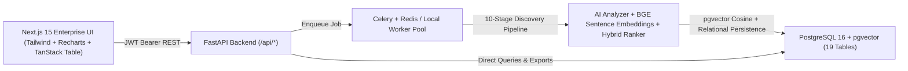

# EDXSO — System Architecture

## Overview
EDXSO School Influencer Intelligence is built as a modular monorepo combining a Next.js App Router enterprise UI, a FastAPI REST API, an asynchronous Celery/Redis discovery worker (with a database-backed local worker fallback), a Sentence Transformers embedding & hybrid ranking engine, and a PostgreSQL + `pgvector` analytical store.

## Core Subsystems

1. **Authentication & User Isolation (`backend/app/api/auth.py`, `deps.py`)**
   - `bcrypt` password hashing, short-lived JWT access tokens + rotating refresh tokens backed by `user_sessions`.
   - `ADMIN` and `USER` RBAC enforcement; strict `owner_id` scoping on private reference profiles, discovery jobs, saved lists, and uploaded datasets.

2. **Compliant Real-Data-Source Adapters (`backend/app/data_sources/`)**
   - `CSVAdapter`, `ManualProfileAdapter`, `AuthorizedAPIAdapter`, `PublicDirectoryAdapter`, `OrganizationWebsiteAdapter`, and `CRMAdapter` normalize exclusively real or user-authorized profiles into `NormalizedCandidateRecord`.
   - Built-in compliance checks enforce `robots.txt`, block restricted domains (`linkedin.com`, `lnkd.in`), and reject synthetic records.

3. **AI Profile Analysis Engine (`backend/app/ai/analyzer.py`)**
   - Extracts professional identity, all 19 K-12 school ecosystem indicators, influence indicators, and date-grounded career context.
   - Tags every attribute as `OBSERVED_FACT`, `AI_DERIVED_CLASSIFICATION`, or `MISSING_INFORMATION` (or `DIRECTLY_OBSERVED` / `SOURCE_SUPPORTED` / `AI_DERIVED` / `UNVERIFIED` on candidates) with exact evidence excerpts.

4. **Semantic Retrieval & Hybrid Ranking (`backend/app/ai/embeddings.py`, `backend/app/ranking/`)**
   - Normalized professional context documents encoded via `SentenceTransformer` (`BAAI/bge-small-en-v1.5` default for CPU/RAM efficiency, configurable to `BAAI/bge-m3`).
   - Optional configurable `CrossEncoderReranker` (`cross-encoder/ms-marco-MiniLM-L-6-v2`).
   - 6-component explainable hybrid ranking with missing-evidence-aware weight normalization and an independent `evidence_confidence` metric + minimum-evidence guardrail.

5. **Persistence & Migrations (`backend/app/models/`, `backend/migrations/`)**
   - 19 relational & vector tables managed via Alembic (`0001_initial_schema.py`), creating the PostgreSQL `vector` extension and `hnsw` cosine index automatically when running against PostgreSQL.
